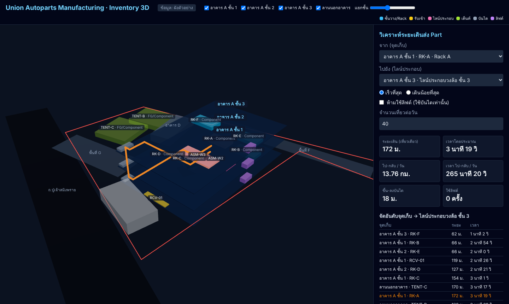
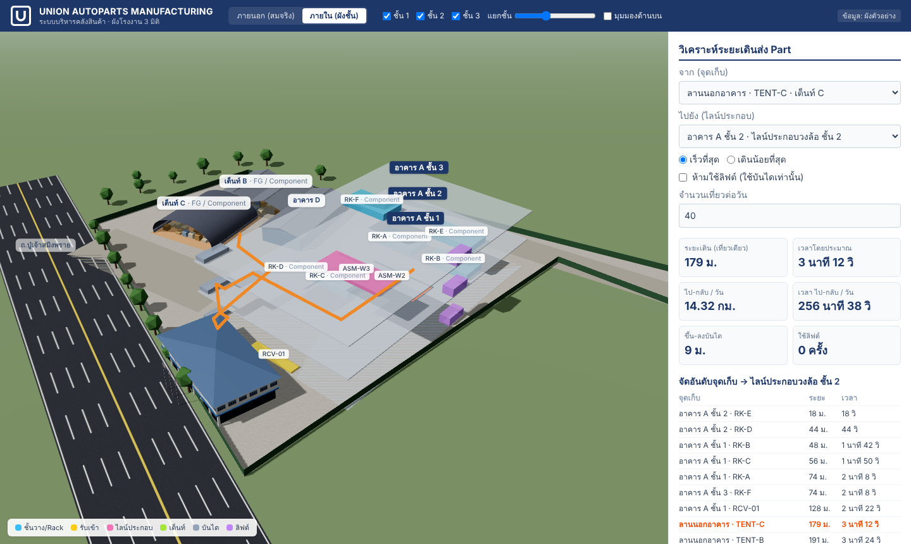

# YA Inventory Management — 3D Visualization

ระบบจัดการสินค้าและคลังรับเข้าของ **Union Autoparts Manufacturing** พร้อมผังโรงงานแบบ 3D
(อาคาร 3 ชั้น + ลานนอกอาคารที่มีเต็นท์ 2 หลัง) และเครื่องมือ **วิเคราะห์ระยะเดิน** ที่พนักงานใช้เบิก part
ไปส่งไลน์ประกอบวงล้อชั้น 2 และชั้น 3

> สถานะ: **เฟส 1 — ภาพรวมพื้นที่** ผัง site (อาคาร A, เต็นท์ B/C, สำนักงาน, ถนน) ประมาณจากภาพดาวเทียม
> ส่วนรายละเอียดภายในอาคาร A ยังเป็นค่าสมมติ ดูหัวข้อที่ต้องเก็บข้อมูลได้ที่ [docs/requirements.md](docs/requirements.md)

| ภายนอก (สมจริง) | ภายใน (ผังชั้น) |
|---|---|
|  |  |

## Tech Stack

| ส่วน | เทคโนโลยี |
|---|---|
| UI | React 19 + TypeScript + Vite + Tailwind CSS |
| 3D | Three.js ผ่าน React Three Fiber + drei |
| Database / Auth / Realtime | Supabase (Postgres) |
| Test | Vitest |

## เริ่มต้นใช้งาน

```bash
cd web
npm install
npm run dev        # เปิด http://localhost:5173
npm test           # ทดสอบการคำนวณเส้นทาง
npm run build
```

ถ้าไม่ได้ตั้งค่า Supabase แอปจะใช้ผังตัวอย่างจาก `web/src/data/factoryLayout.ts`

### เชื่อมต่อ Supabase

1. สร้างโปรเจกต์ใน [supabase.com](https://supabase.com)
2. รันไฟล์ใน `supabase/migrations/` ตามลำดับ แล้วตามด้วย `supabase/seed.sql` (ใช้ SQL Editor หรือ `supabase db push`)
3. คัดลอก `web/.env.example` เป็น `web/.env.local` แล้วใส่ URL และ anon key ของโปรเจกต์

ถ้าแก้ผังใน `factoryLayout.ts` ให้รัน `npm run seed:generate` เพื่อสร้าง `seed.sql` ใหม่

## ฟีเจอร์ตอนนี้

- **โหมดภายนอก (สมจริง)**: โมเดลอาคารตามภาพถ่ายหน้าโรงงาน — อาคาร A ผนังเมทัลชีทสีขาวลอนแนวนอน หลังคาและแถบคั่นชั้นสีฟ้า
  ชั้นล่างแถบเขียว + ประตูม้วน, เสาขาว, พื้น epoxy เขียว/เหลือง, ป้ายชื่อบริษัทพร้อมโลโก้ UAM จริง, สำนักงานใหญ่พร้อมเสาธง, เต็นท์ B (จั่วคู่) / C และ D (ทรงโค้ง), ถนน, รั้วสีเขียว, ต้นไม้
- **โหมดภายใน (ผังชั้น)**: พื้น epoxy ตีเส้นตามมาตรฐาน 5S, เสาพร้อมแถบกันชน, selective rack ที่วางพาเลทตามยอดสต็อกจริง (สีตาม Model),
  ไลน์ประกอบวงล้อ (สายพาน, โต๊ะงาน, พนักงาน, Andon), จุดรับเข้า + รถบรรทุก, พื้นที่ตรวจ MI3, พื้นที่กัก NG, ที่ชาร์จรถยก, บันได/ลิฟต์
- **แก้ไขผัง**: ลากย้าย rack / ไลน์ประกอบ / จุดรับเข้า, หมุน, ปรับขนาด, ย้ายชั้น, เพิ่ม/ลบ — ทางเดินและระยะเดินส่ง Part คำนวณใหม่ทันที
- ธีมองค์กรสีน้ำเงินตามโลโก้ UAM (โลโก้ที่ `web/src/assets/uam-logo.png`) โทนสีทั้งหมดอยู่ที่ `web/src/data/brand.ts`
- ผัง site ตามพื้นที่จริง: ขอบที่ดิน, อาคาร A (3 ชั้น วางเอียงตามแนวจริง), เต็นท์ B/C/D, สำนักงาน E, ถนน
- หมุน/ซูมได้, เลือกซ่อนหรือแสดงทีละชั้น, ปรับระยะห่างระหว่างชั้นได้ และมีมุมมองด้านบนไว้เทียบกับภาพดาวเทียม
- คลิก rack/เต็นท์ เพื่อเลือกต้นทาง และคลิกไลน์ประกอบเพื่อเลือกปลายทาง ระบบจะวาดเส้นทางเดินให้
- คำนวณระยะเดิน, เวลา, ระยะเดินบนบันได, จำนวนครั้งที่ใช้ลิฟต์ และระยะเดินรวมต่อวัน
- จัดอันดับทุกจุดเก็บตามระยะห่างจากไลน์ประกอบ เพื่อช่วยตัดสินใจว่าควรย้าย part ไปไว้ที่ไหน
- Schema ฐานข้อมูล: part, location, stock, ใบรับเข้า, movement ledger, `post_receipt()` และ `move_lot()` ที่บังคับกฎการเบิก/ตรวจ

## รับเข้า & สต็อก (Demo)

- **รับสินค้าเข้า**: ถ่ายภาพ invoice → AI อ่านรายการ (ตอนนี้จำลอง, เตรียม Qwen-VL ไว้ที่ `supabase/functions/extract-invoice`)
  → เทียบ Part Master (แก้รหัส OCR ผิดให้อัตโนมัติ) → แนะนำโซนตามลูกค้า + กลุ่มสินค้า → นับของจริง → ยืนยันรับเข้า
- **ใบรายงาน STOCK ประจำวัน**: หน้าตาเดียวกับฟอร์มเดิมของแผนก W/H ASSY คำนวณจากรายการเคลื่อนไหว แยกตามวัน
- **การเคลื่อนไหวของ lot**: MRA เบิก, ส่งตรวจ MI3, ผลตรวจดี/NG, เจอ NG ในกระบวนการ, ส่งคืน NG — Model อื่นที่ไม่ใช่ K1G ต้องผ่าน MI3 ก่อนเบิก
- **รายงานความต่าง** invoice กับของจริง (ขาด/เกิน/เสียหาย) และ **ติดตาม Lot** ย้อนกลับไปหา invoice ต้นทาง
- Master ตัวอย่าง: Royal Enfield K1G 34 รายการ · รายละเอียดการออกแบบที่ [docs/inventory-process.md](docs/inventory-process.md)

## เอกสาร

- [docs/inventory-process.md](docs/inventory-process.md) — กระบวนการรับเข้า → BOI → MI3/MRA → NG, กฎของระบบ และขั้นตอนเปิดใช้ Qwen

- [docs/requirements.md](docs/requirements.md) — แบบฟอร์มเก็บ requirement และแผนแบ่งเฟส
- [docs/architecture.md](docs/architecture.md) — สถาปัตยกรรม, เหตุผลที่เลือก Supabase, วิธีคำนวณระยะเดิน และข้อเสนอแนะ
